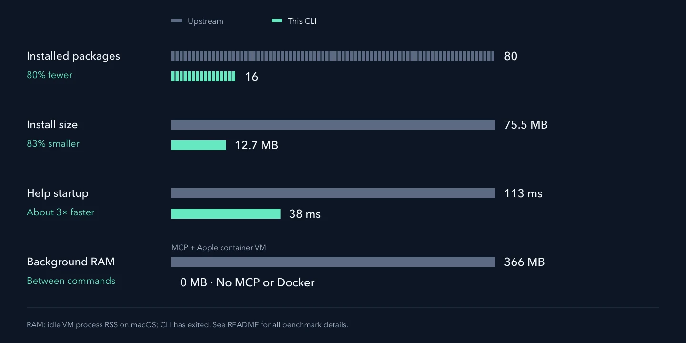

# Paper Search CLI

Search academic sources, look up DOIs, download PDFs, read paper text, and follow citations from the terminal. No Docker, browser, or server is needed.

A CLI-focused fork of [openags/paper-search-mcp](https://github.com/openags/paper-search-mcp). The paper operations remain available. MCP and its server integrations have been removed.

## Same paper tools, less to install

**80% fewer packages. 83% smaller install. About 3× faster startup.** All 71 default paper operations remain available through the CLI.



Measured on macOS arm64 with Python 3.13.7 on 11 October 2026, comparing fresh installs of [upstream `cab1b5c`](https://github.com/openags/paper-search-mcp/commit/cab1b5c) and this fork's `0.2.0` wheel. Package counts include the application and exclude development tools. Size is the sum of installed file bytes in decimal MB. Startup is the median of five `paper-search --help` launches. Network search speed depends on providers.

## Install

Requires Python 3.10+ and [uv](https://docs.astral.sh/uv/getting-started/installation/).

```bash
uv tool install 'git+https://github.com/fcakyon/paper-search-cli'
paper-search --help
```

Or run without a permanent tool installation:

```bash
uvx --from 'git+https://github.com/fcakyon/paper-search-cli' \
  paper-search search 'object detection' -s fast -n 5
```

These commands install this fork from GitHub. The upstream PyPI package has a different feature set. Append `@<commit>` to the Git URL to pin a revision.

## Search and DOI lookup

```bash
paper-search search 'object detection' -s fast -n 5
paper-search search 'object detection' -s arxiv,openalex --sort date
paper-search tool get_crossref_paper_by_doi 10.1038/nature12373
paper-search tool search_crossref 'object detection' --filter from-pub-date:2026-01-01
paper-search sources
```

- `-s fastest`: OpenAlex and Crossref.
- `-s fast`: OpenAlex, Crossref, arXiv, PubMed and Europe PMC. Adds Semantic Scholar when its key is configured.
- `-s all`: broad public-source search, also the default. It can be slow when providers retry.
- `-n`: maximum results per source. Explicit selections are never expanded, including for DOI queries.
- `--sort date` and `--sort citations`: sort retrieved results after deduplication.
- `--source-timeout 45`: optional deadline per source, with at most four short-lived Python processes. Successful sources retain their results when another times out.

Search returns JSON with `papers`, `sources_used`, `source_results`, and `errors`. A partial search can exit successfully. Inspect `errors` before treating it as complete.

## PDFs and paper text

```bash
paper-search download arxiv 1706.03762 -o ./downloads
paper-search read arxiv 1706.03762 -o ./downloads
paper-search tool download_with_fallback arxiv 1706.03762 --save-path ./downloads
paper-search tool extract_sections 1706.03762.pdf --max-pages 20
```

`download` checks the returned artifact is a readable, nonempty PDF. `read` prints paper text. Fallback retrieval tries the original source and open repositories, then Unpaywall when a DOI and contact email are available. It returns a path or a failure message. Sci-Hub remains explicit opt-in through `--use-scihub`.

Section extraction reads a relative PDF path under the configured download root and requires working POSIX address-space and CPU resource limits. The upstream worker fails to apply its address-space limit on some macOS systems. Ordinary PDF download and reading remain available. See [section extraction](docs/PDF_SECTIONS.md) for limits and path rules.

Metadata access does not grant full-text access. Some providers return an explanation when direct reading is unavailable. Google Scholar and publisher sites may reject scripted requests. Institutional entitlement is not covered by offline tests.

## Citations, references, and cache

```bash
paper-search tool get_citing_papers 10.1038/nature12373 --max-results 10
paper-search tool get_referenced_papers 10.1038/nature12373 --max-results 10
paper-search tool get_search_cache_status
paper-search tool clear_search_cache
```

The cache is off by default. See [cache configuration](docs/SEARCH_CACHE.md) and [citation lookup budgets](docs/OPENALEX_RELATIONSHIPS.md).

## All paper operations

```bash
paper-search tool --help
paper-search tool --list
paper-search tool search_scopus --help
paper-search tool search_iacr cryptography --no-fetch-details
```

Required arguments are positional. Optional arguments use `--kebab-case` flags. Boolean options accept `--flag` and `--no-flag`. Objects and lists are JSON. Text and paths are plain text. Exceptions return JSON errors with exit code 1. Invalid command syntax exits with code 2.

The operation list covers provider searches, DOI lookup, downloads, reading, fallback retrieval, PDF sections, citations, references and cache controls. IEEE operations appear when an IEEE key is configured.

## Configure sources

Existing settings remain compatible: `~/.config/paper-search-mcp/.env`, `PAPER_SEARCH_MCP_*` variables, and their documented legacy aliases. Set `PAPER_SEARCH_MCP_ENV_FILE` to use another file.

```dotenv
PAPER_SEARCH_MCP_UNPAYWALL_EMAIL=you@example.com
PAPER_SEARCH_MCP_OPENALEX_API_KEY=
PAPER_SEARCH_MCP_SEMANTIC_SCHOLAR_API_KEY=
PAPER_SEARCH_MCP_CORE_API_KEY=
PAPER_SEARCH_MCP_IEEE_API_KEY=
PAPER_SEARCH_MCP_SCOPUS_API_KEY=
PAPER_SEARCH_MCP_WOS_API_KEY=
```

Public sources can be used without these keys, subject to provider limits. Unpaywall needs a contact email. IEEE, Scopus and Web of Science require credentials and may require institutional access. Select institutional sources explicitly even when keys are configured.

SOCKS proxy support is optional:

```bash
uv tool install 'paper-search-cli[proxy] @ git+https://github.com/fcakyon/paper-search-cli'
```

## Agent skill

The [paper-search skill](claude-code/SKILL.md) documents the CLI for agents with shell access.

#### Skill ZIP uploads and other Claude runtimes

A skill archive contains instructions, not the CLI or its dependencies. From a checkout:

```python
from zipfile import ZIP_DEFLATED, ZipFile

with ZipFile("paper-search-skill.zip", "w", compression=ZIP_DEFLATED) as archive:
    archive.write("claude-code/SKILL.md", arcname="paper-search/SKILL.md")
```

The receiving runtime must be able to run the CLI and reach paper sources. Upload acceptance in other runtimes has not been validated.

## Development

```bash
uv sync --extra dev
uv run pytest tests/test_cli_contracts.py tests/test_cli_tools.py tests/test_scopus.py
```

Five direct libraries handle HTTP, feeds, HTML, PDF text, and argument schemas: Requests, Feedparser, Beautiful Soup, pypdf, and Pydantic. Removing these would mean maintaining replacement parsers or validators.

CI tests built wheels on Linux, macOS and Windows, and the full deterministic suite on Linux. Live provider tests are separate. This project retains the upstream MIT license and attribution.
